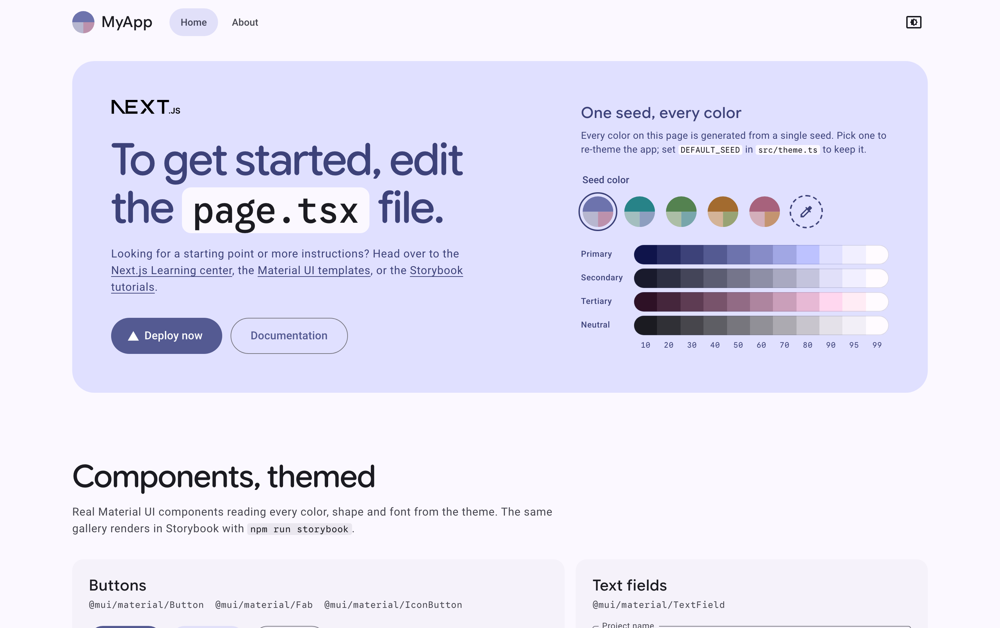

# Next + MUI + Storybook



A WIP example [Next.js](https://nextjs.org/) 16 application that leverages [Material UI](https://mui.com/material-ui/) 9 and [Storybook](https://storybook.js.org/) 10.

## Demo

Soon™

## Requirements

- Node.js 26 LTS (see `.nvmrc`; run `nvm use`)

## Installation

Install the project and run:

```bash
  npm install
  npm run dev
```

Open [http://localhost:3000](http://localhost:3000) with your browser to see the result.

Other scripts:

```bash
  npm run build            # Production build
  npm run lint             # ESLint (flat config in eslint.config.mjs)
  npm run storybook        # Storybook dev server on :6006
  npm run build-storybook  # Static Storybook build
  npm run test-storybook   # Run every story as a test (Vitest + Playwright)
```

The first time you run the story tests, install the browser they use:

```bash
  npx playwright install chromium
```

## Features

- Next.js App Router with Turbopack
- A Material 3 theme generated from one seed color (`DEFAULT_SEED` in `src/theme.ts`) with [Material Color Utilities](https://github.com/material-foundation/material-color-utilities): tonal primary, secondary and tertiary roles, surface-container tiers, light and dark schemes
- A live seed picker on the home page that re-themes the whole app, plus a gallery of themed MUI components
- Material UI with CSS theme variables and a light / dark / system mode switch
- Storybook (`@storybook/nextjs-vite`) with stories rendered in the app's MUI theme and a light/dark toolbar toggle
- Every story runs as a test, including play-function interactions and automated accessibility checks

## Project structure

```
src/
├── app/                  # Next.js App Router (layout, pages)
├── components/           # MUI components, each with a colocated *.stories.tsx
├── stories/              # Storybook welcome page and page-level stories
└── theme.ts              # MUI theme: seed color, generated palette, typography, component overrides
.storybook/               # Storybook config (main.ts) and MUI theme decorator (preview.tsx)
```

## Authors

- [@mikegoforth](https://www.github.com/mikegoforth)

## Acknowledgements

- Bootstrapped from [`create-next-app`](https://nextjs.org/docs/app/api-reference/cli/create-next-app).
- Based on the [Material UI - Next.js App Router example in TypeScript](https://github.com/mui/material-ui/blob/master/examples/material-ui-nextjs-ts/) by [MUI](https://github.com/mui).
- Uses [Storybook for Next.js (Vite)](https://storybook.js.org/docs/get-started/frameworks/nextjs-vite) and the [Vitest addon](https://storybook.js.org/docs/writing-tests/integrations/vitest-addon).
